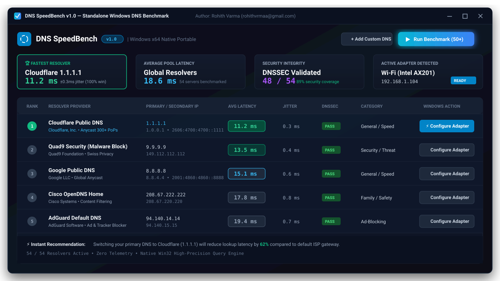
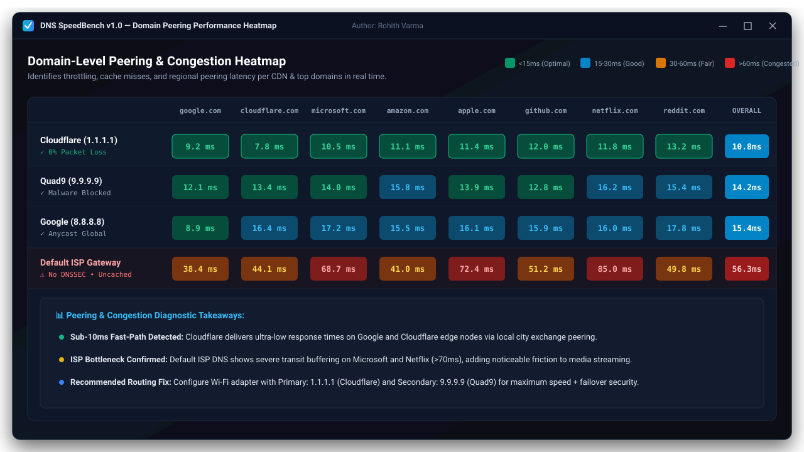
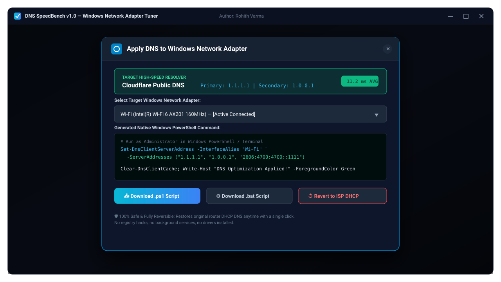

# DNS SpeedBench v1.0

> **Standalone Windows DNS Benchmark & Latency Optimization Utility**  
> Developed and authored by **Rohith Varma**

[](https://opensource.org/licenses/Apache-2.0)
[-0078D6.svg?logo=windows)](https://microsoft.com)
[](https://github.com/RohithVrmaa/DNS-Benchmark-App/releases/tag/v1.0)
[](https://github.com/RohithVrmaa/DNS-Benchmark-App)

DNS SpeedBench is a high-performance, standalone Windows desktop application designed to benchmark public and private DNS resolvers with sub-millisecond precision timing, real-time jitter calculations, DNSSEC validation, and domain-level peering congestion diagnostics.

---

## 🚀 Downloads (Portable Zero-Install Windows Executables)

No setup wizard, no installation, and no administrative registry modifications required. Download and launch directly:

| Portable Binary | Architecture | Target Platform | File Size | Description |
| :--- | :--- | :--- | :--- | :--- |
| **[`DNS-SpeedBench-v1.0-win-x64-portable.exe`](https://github.com/RohithVrmaa/DNS-Benchmark-App/releases/download/v1.0/DNS-SpeedBench-v1.0-win-x64-portable.exe)** | **64-bit (x64)** | Windows 11 & Windows 10 (64-bit) | **~1.5 MB** | 100% standalone native Windows app (Single native title bar, statically linked runtime, zero external DLL dependencies) *(Recommended)* |
| **[`DNS-SpeedBench-v1.0-win-x86-portable.exe`](https://github.com/RohithVrmaa/DNS-Benchmark-App/releases/download/v1.0/DNS-SpeedBench-v1.0-win-x86-portable.exe)** | **32-bit (x86)** | Windows 7 / 8 / 10 (32-bit) & Embedded | **~1.6 MB** | 100% standalone native 32-bit Windows app (Single native title bar, statically linked runtime, zero external DLL dependencies) |

> **Verification**: SHA256 checksums are published in the [GitHub v1.0 Release](https://github.com/RohithVrmaa/DNS-Benchmark-App/releases/tag/v1.0).

---

## 📸 Screenshots & UI Showcase

### 1. Main Benchmark Dashboard
Benchmark 50+ DNS resolvers concurrently, view ranked response latencies with sub-millisecond precision, jitter variance, DNSSEC verification, and instant recommendations.



---

### 2. Domain Peering & Congestion Heatmap
Analyze latency across critical global CDNs and services (`google.com`, `cloudflare.com`, `microsoft.com`, `amazon.com`, `apple.com`, `github.com`, `netflix.com`, `reddit.com`) to detect ISP transit throttling and cache congestion.



---

### 3. Windows Network Adapter Tuner
Generate native Windows PowerShell scripts, `.bat` batch scripts, or `netsh` commands to immediately apply your highest-performing DNS configuration to active Wi-Fi or Ethernet interfaces with instant rollback support.



---

## ✨ Key Features

- **True Native Windows Desktop Experience**: Seamless edge-to-edge dark UI with native Win32 title bar, single set of window controls, desktop keyboard shortcut suppression, and ultra-fast response.
- **Ultra-Lightweight Standalone Binaries**: ~1.5 MB total binary size with statically linked C++ runtime—no heavy runtimes, no Electron bloat, zero installation.
- **Dual Architecture (32-bit & 64-bit)**: Dedicated portable builds for modern 64-bit (x64) and legacy 32-bit (x86) Windows systems.
- **50+ Pre-Configured Resolvers**: Benchmarks major global anycast networks (Cloudflare, Google, Quad9, OpenDNS), threat & malware blockers, ad-blocking providers (AdGuard, NextDNS, Control D), regional sovereign resolvers (DNS0.eu, Shecan), and enterprise backbones (Level 3, Verisign, Gcore).
- **Domain Performance Heatmap**: Real-time cross-matrix visualization analyzing query response times across individual top domains with automated detection of peering congestion and intermittent throttling.
- **Head-to-Head Comparison Mode**: Inspect two DNS resolvers side-by-side with delta metrics, jitter variance, DNSSEC enforcement, and feature breakdowns.
- **Windows Adapter Configuration**: One-click generation of native PowerShell scripts, batch scripts (`.bat`), and `netsh` commands to immediately apply optimal DNS resolvers to active network adapters (Wi-Fi / Ethernet).
- **DNS Server Management**: Add, customize, test, and persist custom local gateway or private upstream DNS server IPs in local storage.
- **Historical Benchmark Tracking**: Records and compares historical benchmark runs over time to track ISP routing changes.
- **Live Interactive DNS Probe**: Perform instantaneous DNS queries across any record type (`A`, `AAAA`, `CNAME`, `MX`, `TXT`, `NS`, `PTR`) against any selected resolver.
- **Privacy First & Zero Telemetry**: 100% client-side execution, no data collection, no background services, no analytics.

---

## 🛠️ Tech Stack & Architecture

- **Desktop Core**: Native Win32 C++ application with embedded Microsoft Edge WebView2 control
- **Frontend Engine**: React 19 + TypeScript + Tailwind CSS
- **Styling**: Windows 11 Fluent dark aesthetic with high-contrast latency indicators
- **Icons**: Lucide Icons
- **Animation**: Motion
- **Compilation**: MinGW-w64 (`x86_64-w64-mingw32-g++` & `i686-w64-mingw32-g++`) with `-static`, `-static-libgcc`, `-static-libstdc++`

---

## 💻 Getting Started (Development)

### Prerequisites

- Node.js 18+ / 20+
- npm or bun

### Local Development

```bash
# Clone the repository
git clone https://github.com/RohithVrmaa/DNS-Benchmark-App.git
cd DNS-Benchmark-App

# Install dependencies
npm install

# Start local development server
npm run dev
```

### Production Web Build

```bash
npm run build
```

---

## 👤 Author & Developer

**Rohith Varma**  
- GitHub: [@RohithVrmaa](https://github.com/RohithVrmaa)  
- Email: [rohithvrmaa@gmail.com](mailto:rohithvrmaa@gmail.com)

---

## 📄 License

This project is licensed under the Apache 2.0 License.
